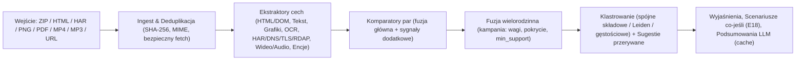

# Metodologia — Methadata (Kolekcjoner Fejków)

## 1. Cel i architektura potoku

**Methadata** łączy materiały reklamowe i strony docelowe (zapisy stron HTML/MHTML, archiwa ZIP, pliki HAR, zrzuty ekranu, dokumenty PDF, nagrania MP4/WebM i audio MP3/WAV/OGG oraz adresy URL/domeny) w **wyjaśnialne grupy kampanii**. Każde połączenie w grafie jest poparte mierzalnymi dowodami i możliwą do sprawdzenia ścieżką obliczeń.

---

## 2. Ekstrakcja cech i wielomodalne sygnały

| Modalność | Ekstraktor / Komparator | Co wydobywa i porównuje |
| --- | --- | --- |
| **Grafiki i wygląd** | `assets`, `perceptual` (pHash, ORB), `visual-embedding` (OpenCLIP `ViT-B-32`) | Identyczne pliki (SHA-256), percepcyjne hashe 64-bit (odległość Hamminga), punkty kluczowe ORB oraz semantyczne embeddingi obrazów i wycinków (whole / grid 2×2 / center 50%). |
| **Tekst i narracja** | `lexical`, `near-copy` (5-gramy Jaccard), `semantic` (MiniLM), `narrative-slots` | Podobieństwo leksykalne, bliskie kopie tekstu, wielojęzyczne embeddingi akapitów (`paraphrase-multilingual-MiniLM-L12-v2`) oraz schematy narracji (haczyk, obietnica, CTA). |
| **Struktura stron i kod** | `extract-html`, `dom`, `extract-code` (`shared-script-v1`) | Sekwencje znaczników DOM, szablony CSS/HTML oraz identyczne skrypty JS (SHA-256). |
| **OCR i dokumenty** | `ocr-layout` (RapidOCR), `extract-documents` (pypdf) | Tekst odczytany ze zrzutów ekranu i kreacji graficznych wraz z układem geometrycznym oraz tekst/metadane z plików PDF. |
| **Sieć i infrastruktura** | `network`, `url-har`, `enrichment.py` (DNS / TLS / RDAP) | Łańcuchy przekierowań HAR, zagnieżdżone docelowe URL w trackerach reklamowych, wspólne piksele/trackery (np. `meta_pixel`), adresy IP hostingu, wystawcy certyfikatów TLS oraz rejestratorzy i daty rejestracji domen (RDAP). |
| **Wideo, audio i mowa** | `video-audio-extractor` (`ffmpeg`, `faster-whisper`, **SpeechBrain ECAPA-TDNN**) | Klatki kluczowe i cięcia ujęć (pHash), 16-bitowy odcisk spektralny audio (Haitsma–Kalker), transkrypcja mowy (Whisper `tiny`) oraz 192-wymiarowy embedding głosu mówcy (`speechbrain/spkrec-ecapa-voxceleb`, z fallbackiem widmowym). |
| **Osoby, marki, kontakty** | `people-entities`, `reference_visual.py`, `source-contact` (HMAC PII), `source-affiliate` | Wzmianki o osobach publicznych, markach i produktach w tekście, opcjonalne dopasowanie wizualne do katalogu referencyjnego (`var/reference_figures/`), zahashowane dane kontaktowe (telefon/e-mail) oraz kody afiliacyjne. |

---

## 3. Fuzja dowodów, progi i wyjaśnialność

1. **Profil główny (`kampania`, `configs/fusion/eval.json`):**
   - Łączy trzy niezależne rodziny dowodów o równych wagach: **Grafiki (`asset`)**, **Tekst (`content-text`)** oraz **Struktura HTML (`dom-structure`)**.
   - Krawędź potwierdzona (linia ciągła w grafie) wymaga:
     - wyniku łącznego $\ge 0{,}50$,
     - pokrycia dostępnych rodzin $\ge 0{,}50$,
     - wsparcia co najmniej **2 niezależnych rodzin** (`min_support = 2`).
   - Dla par wspartych wyłącznie przez tekst i DOM (bez wspólnych grafik) system dodaje jawne zastrzeżenie, że wynik wskazuje na podobieństwo narracji i szablonu, a atrybucja wspólnego nadawcy wymaga dodatkowych dowodów.
2. **Sugerowane połączenia i ręczna weryfikacja:**
   - Pary niespełniające pełnego progu fuzji, ale mające silny sygnał pomocniczy ($\ge 0{,}35$, np. ten sam Meta Pixel w HAR, wspólne skrypty, MiniLM, OpenCLIP, Whisper lub SpeechBrain), wyświetlane są w grafie jako **linie przerywane**.
   - Analityk może ręcznie zatwierdzić dowolne sugerowane lub dodatkowe dopasowanie (**Zatwierdź połączenie**), promując je do potwierdzonej krawędzi w bazie SQLite (z możliwością cofnięcia).
3. **Analiza kontrfaktyczna (Scenariusze co-jeśli, E18):**
   - W panelu dowodów analityk może wyłączać wybrane rodziny sygnałów (`Grafiki`, `Tekst`, `Struktura HTML`) i sprawdzić na żywo, czy para nadal spełniałaby kryteria połączenia oraz jak zmienia się przynależność do grupy.
4. **Podsumowania grup (LLM z cache):**
   - Każda wykryta grupa dostaje jednozdaniowe podsumowanie. Domyślnie jest ono deterministyczne i oparte wyłącznie na wynikach: liczba materiałów, wspólne rodziny cech i najwyższe podobieństwo, a gdy rodziny cech nie są znane, zostaje ogólna formuła „Hipoteza kampanii…”, bez zgadywania.
   - Po świadomym włączeniu (`METHADATA_ENABLE_LLM=1` oraz `OPENAI_API_KEY`; domyślnie wyłączone) podsumowanie generuje `gpt-4o-mini` ze zwartego dossier (nagłówki, fragmenty tekstu do 220 znaków, domeny, trackery, wspierające rodziny), z trwałym cache SHA-256 na dysku. Co dokładnie opuszcza komputer, opisuje sekcja „Dane wychodzące i prywatność” w README. Podsumowanie jest opisem pomocniczym i nie wpływa na grupowanie.

---

## 4. Deduplikacja i obsługa niepełnych danych

- **Deduplikacja:** Identyfikator kanoniczny materiału (`capture_identity`) wyliczany jest ze skrótów SHA-256 artefaktów, a wielokrotne importy tego samego zapisu łączą źródła i daty bez dublowania węzłów w grafie.
- **Niepełne dane i martwe domeny:**
  - Sam adres URL (lub martwa domena, której nie udało się pobrać w `fetch`) jest zapisywany wraz z lekkim artefaktem HAR i zagnieżdżonymi domenami z parametrów trackera, dzięki czemu `url-har-extractor` nadal potrafi powiązać go po domenie z innymi materiałami.
  - Zrzuty ekranu bez HTML (brak DOM/tekstu strony) nadal są analizowane przez pHash, ORB, OCR (RapidOCR) i OpenCLIP.
  - Nagrania wideo bez ścieżki audio lub ciche nagrania jawnie oznaczają odpowiednią cechę jako `unsupported`, bez przerywania analizy pozostałych modalności.
  - Wzbogacanie domen (DNS/TLS/RDAP) dotyczy wyłącznie nazw publicznych: nazwy niebędące poprawnymi hostami oraz hosty wskazujące na adresy prywatne, loopback lub link-local są pomijane bez żadnych zapytań wychodzących, a połączenie TLS idzie do zweryfikowanego adresu IP. Martwa domena nadal dostaje publiczne metadane RDAP (rejestrator, data rejestracji).
  - Dane wrażliwe (telefony/e-maile w `source-contact`) są hashowane algorytmem HMAC-SHA256 z lokalnym kluczem (`METHADATA_PII_KEY` / `var/pii.key`).

---

## 5. Zaobserwowane wzorce kampanii oszukańczych

W lokalnym korpusie testowym system automatycznie wyodrębnia charakterystyczne wzorce kampanii:
- **Fałszywe wywiady z osobami publicznymi (np. rzekomy zamach / inwestycje):** wielokrotne kopie identycznego szablonu artykułu prasowego (pokrycie tekstu i DOM ~99–100%) hostowane na rotujących, krótkotrwałych domenach (`.click`, `.live`) współdzielących ten sam `meta_pixel` oraz skrypty JS.
- **Warianty narracyjne na wspólnym szablonie:** strony różniące się wykorzystanym wizerunkiem/osobą (brak identycznych grafik), ale łączone przez strukturę HTML/CSS, schemat narracji i wspólne hosty zaplecza.
- **Powtarzalne kreacje i regulaminy:** wspólne grafiki (pHash/SHA-256) oraz identyczne stopki/regulaminy i skrypty śledzące łączące pozornie osobne strony docelowe.

---

## 6. Model autorski: PhyloFake v1 (Filogeneza Kampanii i Koszt Obejścia)

Ponad standardową fuzją podobieństw Methadata uruchamia autorski silnik **`src/methadata/phylofake/engine.py`** łączący 4 mechanizmy ukierunkowane na taktykę operatorów kampanii oszukańczych:

1. **Adversary-Cost Information Gain (ACIG):** każdemu wspólnemu śladowi przypisywana jest waga $w(f) = \left(\log\frac{N+1}{\mathrm{df}(f)+1} + 0{,}15\right) \times C_{\text{mutate}}(f)$, gdzie $C_{\text{mutate}}$ odzwierciedla koszt zmiany elementu po stronie oszusta (wysoki dla `meta_pixel`, skryptów JS, hostingu IP/rejestratora, głosu SpeechBrain i szkieletu DOM; niski dla rotowanej domeny lub podmienionego zdjęcia).
2. **Detekcja mutacji Slot-Swap:** zamiast karać różnice wizerunkowe, silnik klasyfikuje każdą relację na **`CLONE`**, **`CELEBRITY_SWAP`** (ten sam szablon i zaplecze, podmieniona osoba publiczna — np. `Krzysztof Stanowski ↔ Tomasz Sekielski`), **`PRODUCT_SWAP`**, **`INFRA_REUSE`** lub **`CROSS_MEDIA_BRIDGE`** (most audio/wideo ↔ strona).
3. **Skierowana filogeneza kampanii („Patient Zero”):** w każdej grupie wyznaczany jest szablon źródłowy (najwcześniejszy znacznik czasu z zapisu/RDAP oraz najwyższa centralność w grupie) wraz ze skierowanym drzewem mutacji (oznaczony symbolem `★` na grafie i kartach grup).
4. **2-skokowa dyfuzja na hipergrafie:** wyszukuje ukryte mosty wieloskokowe między materiałami niepołączonymi bezpośrednio (np. `p2 ──[skrypt JS]──▶ p1 ──[Meta Pixel]──▶ p3`).

---

## 6. Nowy materiał względem zbioru i potencjalne nowe kampanie

Kolekcja działa przyrostowo: każdy import dodaje materiały do aktywnego zbioru i tworzy nową wersję grafu. Raport importu opisuje dla każdego nowego materiału jedną z trzech sytuacji:

- **dołączył do istniejącej grupy**: nowy materiał ma co najmniej jedną krawędź spełniającą progi fuzji z członkiem znanej grupy,
- **nowa grupa (potencjalna nowa kampania)**: grupa składa się wyłącznie z materiałów z tego importu, więc nie pasuje do żadnej znanej kampanii,
- **bez grupy**: brak krawędzi spełniającej progi; materiał nie jest łączony z żadną kampanią.

Gdy nowy materiał łączy dwie dotąd osobne grupy, raport wymienia je w komunikacie „Połączono grupy”. Ten sam zapis zaimportowany ponownie jest duplikatem (identyfikator kanoniczny z SHA-256 artefaktów) i nie zmienia grafu.

**Sprawdzone przypadki** (testy automatyczne i przebieg ręczny na świeżej kolekcji): dwie strony tej samej kampanii (to samo hasło i układ, inna końcówka tekstu, te same grafiki) tworzą grupę; trzecia strona z kolejnym wariantem dołącza do niej; strony o innym temacie (kurs programowania, pożyczka online) pozostają poza grupą; ponowny import wszystkich plików daje same duplikaty.

## 7. Zestaw demonstracyjny i walidacja

Zestaw syntetyczny z repozytorium (`backend/methadata_api/demo_data`, generator `generate_demo.py`) ma znany wynik: A i C to warianty jednej kampanii (wspólne grafiki 3/4, to samo hasło, ten sam szablon), B to inna kampania (inny temat tekstu i szablon HTML, z C wspólna tylko jedna grafika). Silnik fuzji zwraca grupę {A, C} (wynik ok. 0,90), a B zostaje osobno (wyniki z A i C ok. 0,15 i 0,20, poniżej progu 0,50). To sprawdza zdolność **niełączenia** materiałów, które nie należą do kampanii.

Jak odtworzyć:

    pytest                                        # backend, silnik, kontrakt HTTP (hermetycznie: bez OpenAI i bez DNS/TLS/RDAP)
    cd frontend && npm test                       # interfejs
    cd tests/web-e2e && npm test                  # pełny przebieg w przeglądarce (docker compose up --build)

Na lokalnym korpusie jury (profil `kampania`) wyniki, progi i próba restartu opisuje README (sekcja „Scenariusz jury”).

## 8. Skan źródła reklam (bonus)

`methadata.monitor` pobiera przyrostowo rekordy reklam z dostawcy (`JsonFileProvider` na eksporcie JSON/JSONL albo Meta Ad Library API), zapisuje kursor i kolejkę analizy atomowo i analizuje tylko nowe lub zmienione rekordy (grupowanie po płatniku). W interfejsie przycisk „Skanuj źródło” wykonuje jeden przebieg na eksporcie lokalnym i pokazuje liczby: nowe, zmienione, bez zmian oraz grupy płatników z nowymi reklamami. Wyniki skanu nie zasilają grafu kolekcji (osobny magazyn), co jest świadomym ograniczeniem tej wersji.

## 9. Ograniczenia

- Podobieństwo wskazuje wspólne materiały, szablon lub narrację, **nie dowodzi wspólnego nadawcy**: dla par wspartych tylko tekstem i strukturą interfejs wyraźnie to zaznacza.
- Dopasowanie wizualne osób opiera się na małej bazie referencyjnej (`data/reference_figures/`: trzy osoby publiczne na wolnych licencjach): pHash zawsze, OpenCLIP w trybie pełnym. pHash wykrywa ten sam kadr zdjęcia (także przeskalowany), a nie każdą inną fotografię tej osoby. Jest sygnałem pomocniczym, nie potwierdzeniem tożsamości.
- Wideo, audio i embeddingi wymagają trybu pełnego (`ffmpeg` i modele ML); w trybie lekkim te cechy są jawnie oznaczone jako niedostępne.
- Grafiki SVG nie mają podglądu (serwujemy tylko obrazy rastrowe z powodów bezpieczeństwa).
- Wyszukiwanie po wskazówce przeszukuje zwięzły indeks tekstu materiału (do 1500 znaków), a nie pełną treść.
- Wyniki dotyczą lokalnego zbioru przykładowego; ocena na nieznanym zbiorze organizatora będzie pierwszym niezależnym sprawdzianem progów.

## 10. Źródła danych i pochodzenie

Zbiór organizatora (materiały `BACKUP`, `scam_links`) pozostaje lokalny i jest wyłączony z repozytorium (`.gitignore`). Zestaw demonstracyjny jest w całości syntetyczny. Publiczne metadane domen pochodzą z DNS, certyfikatów TLS i RDAP; modele i biblioteki wraz z licencjami wymienia tabela w README.
